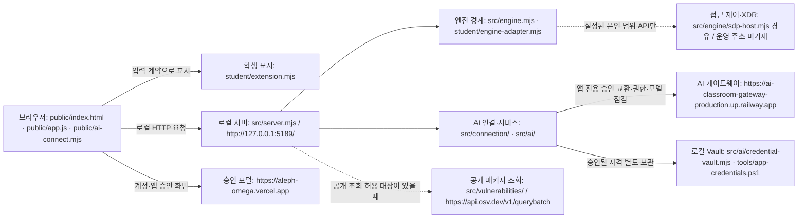

> 이 문서는 21·22단계 당시 제출·확인 기록입니다. 현재 0.2.19 총공세의 실행·변경·한계는 [총공세 실행 기록](FINAL_OFFENSIVE_RUNBOOK.md)을 따릅니다. 아래의 ‘현재’는 해당 기록 작성 시점을 뜻합니다.

# 코덱스 — 학생용 실행 설명서와 시스템 구성도

> 21단계 학생 작성 문서. 2026-10-26 현재 소스와 제공 실행 도구를 대조했다. 제공 화면·실행 도구의 제품명은 여전히 「케셰브」이며 학생 Agent 이름 「코덱스」와 같은 프로젝트를 가리킨다. 이번 단계에서는 제품명·UI·서버·인증 코드를 바꾸지 않는다.

## 1. 목적, 기능 및 지원 범위

코덱스는 브라우저에서 로그인 사용자·기기·세션, 업무 앱 접근 판정, 접속 기록·XDR 경보, AI 연결·사건 설명, 조치 상태와 설치 패키지 취약점 결과를 표시하는 학생용 보안 Agent이다. 제공 코드는 통신과 검증을 담당하고, 학생 코드는 `student/extension.mjs`의 표시 영역을 담당한다.

| 항목 | 선언·지원 범위 | 실제 확인 및 한계 |
|---|---|---|
| 앱 버전 | `package.json`: `alekov-client-starter` 0.2.14 | 버전을 변경하지 않았다. 단계 통과나 최종 버전 완료를 뜻하지 않는다. |
| 운영체제 | 제공 안내의 Windows 10·11 64비트, Windows PowerShell 실행 도구 | 현재 Windows PC에서 기존 실행과 AI 연결을 확인했다. 다른 OS·새 PC에서는 미확인이다. |
| Node.js | `package.json`의 `engines.node`: 24.19.0. 실행 도구는 주 버전 22~24를 허용하고 24.19.0과 다르면 안내한다. | 현재 `node --version`: `v24.20.0`. 24.19.0 자체에서 다시 실행한 결과는 미확인이다. |
| PowerShell | helper는 고정 Windows PowerShell 실행 파일을 사용한다. | Windows PowerShell `5.1.26100.9711`. 문서 조사 셸은 PowerShell `7.6.5`이며 두 환경을 구분한다. |
| npm | `start`, `demo`, `check` 스크립트 제공 | 현재 `npm --version`: `11.19.0`. npm 설치는 별도로 실행하지 않았다. |
| 의존성·잠금 파일 | 앱 `package.json`에 외부 `dependencies`·`devDependencies` 없음 | 현재 앱 폴더에 `package-lock.json` 없음. `npm install`이나 잠금 파일 생성을 요구하지 않는다. OSV 조회 대상 프로젝트의 잠금 파일은 별개다. |
| 브라우저 | JavaScript 실행 가능한 PC 브라우저 | 이전 실제 앱 화면과 AI 점검을 확인했다. 브라우저별 전체 호환성은 미확인이다. |

## 2. 실제 작업 위치와 파일 구조

Git 최상위 폴더는 **`코덱스-agent`**, 앱 실행 위치는 그 안의 **`on-client`**이다. 이하 파일 경로는 별도 표시가 없으면 `on-client` 기준이다.

```text
코덱스-agent/                         ← Git 최상위: 커밋·원문 도구 작업 위치
└─ on-client/                        ← 앱 실행 명령을 입력하는 위치
   ├─ README.md                      제공 안내 + 학생 문서 안내
   ├─ package.json                   실행 스크립트·기준 버전
   ├─ .env.example                   비밀 없는 환경변수 견본
   ├─ .on-starter-manifest.json       제공 파일 기준 목록·해시
   ├─ student/
   │  ├─ extension.mjs               createStudentView()와 학생 렌더러 8개
   │  └─ engine-adapter.mjs           호스트의 본인 범위 API 연결 어댑터
   ├─ public/                        제공 HTML·CSS·브라우저 요청·연결 UI
   ├─ src/
   │  ├─ server.mjs                  로컬 HTTP 서버 진입점
   │  ├─ engine.mjs                  disconnected/demo/connected 엔진 경계
   │  ├─ engine/                     조건부 SDP 호스트 연동
   │  ├─ connection/                 Native 로그인·AI 연결·컨텍스트 검증
   │  ├─ ai/                         앱 자격 검증·모델 점검·설명·Vault 호출
   │  ├─ actions/                    조건부 보안 조치와 결과 관측
   │  └─ vulnerabilities/            잠금 파일과 승인된 공개 패키지 OSV 조회
   ├─ tools/                         시작 도구·Native registry·Vault helper
   ├─ vendor/                        제공 CLCO HTTP 모듈·고지
   └─ docs/STUDENT_CODEX_RUNBOOK.md   이 학생 문서
```

현재 PC의 탐색기에서 `ALEPH\Workbench\projects\코덱스-agent\on-client`를 열고 주소 표시줄에 `powershell`을 입력해 새 창을 연다. 다른 위치에 내려받았다면 그 프로젝트의 `on-client`를 선택한다. 현재 PC에서 확인한 이동 명령은 다음과 같다. 다른 PC의 설치 위치를 보장하는 명령은 아니다.

```powershell
Set-Location -LiteralPath (Join-Path ([Environment]::GetFolderPath('UserProfile')) 'AppData\Local\ALEPH\Workbench\projects\코덱스-agent\on-client')
```

`$env:LOCALAPPDATA`는 앱 격리 환경에서 다른 위치를 가리킬 수 있으므로, 실제 `package.json`과 `tools/start-alekov.ps1`이 있는 폴더인지 먼저 대조한다.

## 3. 시작·종료·재실행

### 확인 1 — 새 PowerShell 창에서 직접 실행

현재 위치가 `on-client`인 새 PowerShell 창에서 다음 순서로 진행한다. 서버를 사용하는 기존 창·다른 프로그램을 임의로 종료하지 않는다.

1. 실제 버전을 확인한다.

   ```powershell
   node --version
   ```

   이 PC에서 확인한 출력은 `v24.20.0`이다. 수업 기준은 `v24.19.0`이다. 제공 도구가 허용하지 않는 버전이면 담당자의 Node 설치 안내를 따른다. 자동 설치 명령은 이 문서에서 만들지 않는다.

2. 같은 창에서 제공 실행 도구를 실행한다. 이 명령은 이 대화의 이전 실제 실행에서 사용했다.

   ```powershell
   powershell -NoProfile -ExecutionPolicy Bypass -File .\tools\start-alekov.ps1
   ```

3. 정상 시작 신호를 확인한다. 소스의 출력 문구는 다음과 같다.

   ```text
   계정 연결 준비가 끝났습니다. 앱에서 확인 번호로 로그인·승인을 진행하세요.
   케셰브가 켜졌습니다. 브라우저에서 http://127.0.0.1:5189/ 을 여세요.
   서버가 응답한 것만 확인했습니다. AI 연결 상태는 화면에서 따로 확인해 주세요.
   끄려면 이 창에서 Ctrl+C 를 누르세요.
   ```

   `참고: 지금 Node.js 는 v24.20.0 입니다. 수업 기준은 v24.19.0 입니다.` 안내가 추가될 수 있다. 주소 안내는 로컬 서버의 시작 확인이며, SDP·AI·단계 판정 성공이 아니다.

4. 브라우저에서 `http://127.0.0.1:5189/`를 연다. 「보호 현황」「업무 앱」「보안 기록」과 제공/학생 표시 영역을 확인한다. 기본 보안 엔진이 `disconnected`이면 실제 로그인·기기·기록에 「연결 없음」이 표시될 수 있다.
5. 종료할 때는 이 명령을 실행한 PowerShell 창에서 **Ctrl+C**를 누른다. 브라우저 탭을 닫는 것만으로 서버는 종료되지 않는다.
6. 같은 폴더에서 2번 명령을 다시 실행하고 브라우저를 새로고침한다. 서버 재시작 후 로그인 확인을 다시 요구할 수 있다. 개인 설정·Vault·registry를 삭제해 초기화하지 않는다.

`npm start`는 `node src/server.mjs`만 실행한다. Native 설정을 자동 준비·전달하는 위 실행 도구와 동일한 계정 연결 준비 절차가 아니다. `npm run demo`는 예제 엔진이며 실제 운영 연결 증거가 아니다. 이번 문서 작업에서는 두 명령을 실행하지 않았다.

학생 파일의 구문 확인은 다음 명령으로 한다. 이번 문서 작업에서 통과했다. UI·권한·실제 서비스 시험을 대신하지 않는다.

```powershell
npm run check
```

이번 문서 작성 중 새 창의 시작→종료→재실행을 다시 수행하지 않았다. 위 사용자 확인 1의 최신 소스 재현 결과는 아직 **미확인**이다. 앞선 실행·연결 기록과 구분한다.

### 확인 2 — 경로·명령·버튼 대조

확인 1을 마친 다음에 수행한다. 「계정 연결 시작」→「계정 확인 페이지 열기」→「로그인 확인 완료」와 「AI 연결 시작」→「승인 페이지 열기」→「승인했으며 연결 확인」은 서로 다른 절차다. 현재 소스와 실제 기존 화면에서 버튼 이름을 확인했다. 이번 문서 작업에서는 새 승인·실제 AI 요청을 하지 않았다.

AI 점검은 「현재 API 연결 점검」 또는 「AI 연결 점검」의 `verified`, 모델 수, 점검 시각을 읽는다. 보안 엔진 `meta.mode`는 별도로 읽는다. `connected` 표시나 `verified`를 과제 통과로 해석하지 않는다. 불일치는 화면 문구·안전한 오류 코드·확인 시각으로 남기고, 확인하지 않은 버튼 동작은 미확인으로 둔다.

## 4. 설정 및 저장 경계

- `.env.example`는 `ON_PORT`, `ON_ENGINE_ADAPTER`, `ON_AI_MODEL`, 공개 패키지 조회 설정 등의 견본이다. 현재 진입 코드에는 `.env` 자동 로더가 없으므로, 견본을 복사하는 것만으로 설정이 적용된다고 안내하지 않는다.
- `tools/start-alekov.ps1`은 Native 설정을 개인 사용자 폴더에 준비하고 `src/server.mjs`에 `--native-host-config`로 전달한다. `tools/prepare-native-host.ps1`이 설정 준비를 담당한다. 설정·Vault·registry는 프로젝트 밖에 있으며 문서와 커밋에 내용을 복사하지 않는다.
- Native 계정 연결과 AI 앱 승인은 SDP 보안 엔진 설정을 대신하지 않는다. 담당자가 승인한 설정이 있어야 제공 `-SdpHostConfig` 옵션과 `student/engine-adapter.mjs`를 통해 보안 엔진을 연결할 수 있다. 실제 설정 경로·주소·인증서를 추측해 만들지 않는다. 이 경로의 실제 동작은 미확인이다.
- 보안 조치는 서버의 별도 활성 조건과 설정이 필요하다. 이번 단계에서 활성화하거나 실행하지 않는다.
- `tools/app-credentials.ps1`은 현재 원본이다. 이전 진단의 임시 코드나 권한 변경 시험을 문서의 설치 필수 절차에 포함하지 않는다.

## 5. 시스템 구성도와 공개 주소



글로 읽는 순서는 **브라우저 → 로컬 앱 서버 → 엔진 어댑터 → 접근 제어·XDR 시스템**, 그리고 별도 가지인 **로컬 앱 서버 → AI 연결/서비스 → AI 게이트웨이**다. 학생 렌더러는 제공 브라우저 코드가 전달한 검증 결과를 표시하며 외부 게이트웨이나 Vault를 직접 호출하지 않는다. 포털은 승인 화면이고 게이트웨이는 승인 교환과 AI 요청 처리 경로다. Workbench 자격증명을 복사하거나 Workbench를 AI 중계 서버로 사용하지 않는다.

점선은 설정·허용 목록이 필요한 조건부 연동이다. 실제 SDP/XDR 주소는 현재 검증되지 않았으므로 작성하지 않았다. 공개된 위 서비스 주소는 소스 상수와 대조했으며, 이번 문서 작성 중 외부 서버에 접속해 상태를 확인한 것은 아니다.

### HTTP·데이터 계약

`public/app.js`는 `{ok,data?,error?,meta:{mode,checkedAt}}` 응답을 검증하고 학생 렌더러에 `status`, `mode`, `data` 또는 `error`를 전달한다. `status`의 `ok`와 `meta.mode`의 `connected`는 서로 다른 값이다. `mode`는 `connected`·`demo`·`disconnected`이며 값이 없으면 학생 표시는 확인 불가로 처리한다.

| 로컬 경로 | 입력·용도 | 해석 |
|---|---|---|
| `GET /api/me`, `/api/devices`, `/api/sessions`, `/api/apps`, `/api/events` | 현재 사용자 범위 조회 | 실패와 정상 빈 배열을 구분한다. XDR 사건 생성이나 조치 실행이 아니다. |
| `POST /api/access` | `{appId}` | `allow`·`deny`·`challenge`·`unknown`, `reason`, `checkedAt`. 허용 판정은 실제 앱 접속 완료가 아니다. |
| `POST /api/native-login/{start,redeem,current,status,cancel}` | `{}` | 계정 연결 절차. 브라우저는 비공개 로그인 자료를 받지 않는다. |
| `POST /api/ai/connect/start` | `{}` | 승인 대기 요청 생성. |
| `POST /api/ai/connect/{finish,status,cancel}` | `{connectionId}` | 확인·조회·중단. 저장 응답과 컨텍스트 검증을 마쳐야 `connected`다. |
| `POST /api/ai/check` | `{}` | `transportChecked`, `audienceAuthorization`, `modelCount`, `help`. 모델 목록 점검이며 사건 설명 생성이 아니다. |
| `POST /api/ai/explain` | `{eventId}` | 선택한 사건의 근거를 서버가 조회·검증한다. 실제 유료 생성 요청은 이번 단계에서 수행하지 않는다. |
| `GET /api/vulnerabilities` | 승인된 조회 설정을 서버가 사용 | 잠금 파일의 정확한 설치 버전과 공개 OSV 결과를 대조한다. |
| `POST /api/actions/{prepare,execute,result}` | 각각 `{eventId,actionId}`, `{requestId,confirmationId}`, `{requestId}` | 제공 조치 경계. 별도 활성 조건과 사람 확인이 필요하며 이번 단계에서 호출하지 않는다. |

## 6. 제공 코드와 학생 함수

`.on-starter-manifest.json`의 기준 파일 목록과 현재 경로를 대조했다. 기준 목록에 포함됐다는 이유로 학생 확장 함수를 제공 코드 성취로 계산하지 않는다. 아래 표는 **현재 코드 구현**의 설명이며 모든 분기를 실제로 시험했다는 뜻은 아니다.

| 구분·파일 | 역할 | 이번 변경 |
|---|---|---|
| 제공 `public/index.html`, `public/app.js`, `public/ai-connect.mjs` | 메뉴·필수 버튼·통신·취소·검증·학생 슬롯 호출 | 없음 |
| 제공 `src/server.mjs`, `src/engine/`, `src/connection/`, `src/ai/`, `src/actions/`, `src/vulnerabilities/` | 로컬 API·인증·접근 제어/AI/조치/조회 경계 | 없음 |
| 제공 `tools/`, `vendor/`, `package.json`, `.env.example` | 실행 도구·helper·제공 모듈·설정 견본 | 없음 |
| 학생 `student/extension.mjs` | `createStudentView()`가 아래 렌더러를 반환 | 이번 문서 단계에서는 없음 |
| 연결 어댑터 `student/engine-adapter.mjs` | 호스트가 넘긴 본인 범위 메서드 전달. 기본 export는 `disconnected` | 없음 |
| 학생 `docs/STUDENT_CODEX_RUNBOOK.md`·README 학생 안내 | 실행·구조·증거 범위 설명 | 이번 문서 작업 |

| 학생 함수·입력 | 현재 구현과 확인할 상태 |
|---|---|
| `renderIdentity({me,devices,sessions})` | 각 resource의 `status`, `mode`, `data`, `error`; 사용자·기기·세션과 목록의 로딩·오류·빈 결과를 구분한다. |
| `renderDecision({status,mode,data,error,appId})` | 대기·조회 중·요청 실패와 접근 판정을 구분하고 앱 ID·이유·시각을 표시한다. |
| `renderEvents({status,mode,data,error})` | 사건 배열을 복사·정렬·필터링하고 상세 근거·규칙·상태를 표시한다. `data-student-event-id`, `data-student-event-detail`을 사용한다. |
| `renderStatus({devices,sessions,notifications,diagnostics,mode})` | 기기·세션·알림과 허용된 진단 항목·사용자 동작에 따른 복사를 표시한다. |
| `renderAiConnection({status,mode,data,error,checkedAt})` | `idle`·`loading`·`ok`·`error` 구분. `data.audienceAuthorization`의 `test`와 `verified`, `modelCount`, 시각을 표시한다. 엔진 `mode`는 「보안 이벤트 엔진」으로 별도 표시한다. 제공 입력의 `explanationAccepted:false`는 현재 함수에서 사용하지 않는다. |
| `renderExplanation({event,explanation,checkedAt})` | 근거 ID·제안·`executed:false`·`requiresHumanConfirmation:true` 등을 확인하고 참고 설명을 표시한다. 검증 성공 때만 `data-student-explanation-event`를 붙인다. 실제 조치를 수행하지 않는다. |
| `renderAction({status,event,actionId,target,receipt,observation,message,confirmationExpiresAt,error})` | `idle`·`loading`·`prepared`·`executing`·`pending`·`succeeded`·`denied`·`failed`·`unknown`·`expired`·`error`를 구분한다. 효과 확인은 `observation.effectApplied === true`일 때만 표시한다. `data-student-action-event`, `data-student-action-request`를 사용한다. |
| `renderVulnerabilities({status,mode,data,error})` | 현재 구현됨. 전체 `data.status`의 `complete`·`partial`·`not_checked`·`not_configured`·`unverifiable`와 패키지별 `known_vulnerabilities`·`none_found`·`unverifiable`을 구분한다. 정확한 버전·출처·시각·취약점 ID를 표시하며 두 `data-student-package-*` 속성을 사용한다. |

기존 `docs/STUDENT_RUNBOOK.md`의 다른 작업을 보존하면서 제출 피드백이 지적한 취약점 함수 설명과 확인 범위를 정정했다. 두 문서의 함수 설명은 현재 작업 트리 원문을 기준으로 하며, 과거 실행 보고와 구분한다.

## 7. 장애 확인·복구 순서

| 상태·오류 | 확인 순서와 안전한 다음 작업 | 성공으로 오해하면 안 되는 것 |
|---|---|---|
| `포트 5189 를 다른 프로그램이 쓰고 있습니다.` | 실행 중인 창과 시작 도구의 주소를 확인한다. 기존 프로그램을 강제로 종료하지 않는다. 제공 `-Port` 옵션은 실행 안내를 참고한다. | 브라우저 새로고침으로 포트 충돌이 해결되는 것은 아니다. |
| Node 미설치·지원 범위 밖 버전 | 실제 작업 위치와 `node --version`을 확인하고 담당자의 설치 안내를 따른다. | 문서의 기준 버전과 현재 설치 버전을 혼동하지 않는다. |
| `ENGINE_NOT_CONNECTED`, 엔진 `disconnected` | 보안 엔진 어댑터와 담당자가 제공한 SDP 설정 유무를 확인한다. 기본 실행의 정상적인 미연동 상태일 수 있다. | AI `verified`와 별개이며 빈 사건 목록으로 바꾸면 안 된다. |
| `NATIVE_HOST_UNVERIFIED`, `NATIVE_HOST_EXPIRED` | 계정 연결 칸의 실제 오류·기한을 읽고 「현재 로그인 확인」 결과를 대조한다. | AI 앱 승인 또는 저장 성공을 뜻하지 않는다. |
| `ALEKOV_CONNECT_CONTEXT_CHANGED` | 로그인·프로젝트·세션이 연결 시작 시점과 같은지 확인한다. | 실제 계정 변경인지 다른 검증 실패인지 코드 하나만으로 단정하지 않는다. |
| `ALEKOV_CONNECT_OUTCOME_UNKNOWN` | 「상태 다시 확인」과 「연결 도움정보 보기」를 사용한다. 요청을 자동 재발급하거나 grant를 회수하지 않는다. | 승인 화면의 승인 완료와 로컬 저장 완료는 다르다. |
| `ALEKOV_VAULT_STORAGE_FAILED` | 담당자가 helper의 고정 단계 진단으로 저장 경로·권한 적용 지점을 확인한다. 비밀 파일 원문은 열어 공유하지 않는다. | 이전 PC 진단에서 초기 Vault의 `Set-Acl` 접근 거부를 확인했다. 현재 원본 helper로 초기화된 Vault의 재연결은 성공했지만 새 빈 Vault 초기화 재현은 미확인이다. 관리자 실행·권한 완화를 기본 해결책으로 요구하지 않는다. |
| AI 점검 `verified`, 모델 수 `1`인데 엔진 미연결 | AI 점검 시각과 별도 엔진 상태를 함께 읽는다. | AI 정상과 보안 엔진 미연결은 함께 존재할 수 있다. |
| AI `test`, 권한 준비 중, 시간 초과·취소 | 시험 연결과 실제 권한 검증을 구분하고 안전한 오류 안내를 따른다. 재점검은 사용자가 직접 수행한다. | 시험·실패를 `verified`로 표시하지 않는다. |
| OSV `not_configured`·`not_checked`·`unverifiable`·`partial` | 서버의 공개 조회 허용 목록과 대상 프로젝트 잠금 파일을 담당자 안내로 확인한다. 기존에 받은 일부 결과와 전체 조회 실패를 구분한다. | `none_found`도 조회 시점·범위 내 결과이며 전체 안전을 보장하지 않는다. |
| 조치 `pending`·`unknown` | 제공 「원천 결과만 재조회」 등 실제 버튼과 결과 관측을 대조한다. 진단 목적의 조치를 임의 실행하지 않는다. | ACK와 AI 제안은 효과 확인이 아니다. |

## 8. 증거 수준과 미확인 기능

| 수준 | 확인한 내용 | 이번 단계에서의 한계 |
|---|---|---|
| 현재 소스 직접 읽음 | 실행 도구, 버전 허용 범위, 모듈·API·학생 함수·설정 견본·버튼 이름 | 실제 운영 연동 전체를 실행한 증거가 아니다. |
| 현재 명령 실행 | Node·npm·PowerShell 버전, 실제 폴더 이동, `npm run check` | 구문 확인과 경로 확인이다. |
| 이전 대화의 모의 확인 | AI 학생 표시 7개 상태 분기와 원본 helper의 별도 임시 ACL 비교 시험 | 실제 SDP·OSV·새 환경 실행을 증명하지 않는다. |
| 이전 실제 PC 실행 | 제공 시작 도구로 앱 HTTP 200 및 브라우저 표시 확인; 원본 helper에서 계정 재연결·새 AI 승인·Vault 저장 이력 `accepted` 확인 | 현재 21단계 문서의 새 PowerShell 절차를 다시 수행한 결과는 아니다. 임시 helper 변경은 원복됐다. |
| 이전 실제 AI 모델 목록 점검 | 2026-10-26 14:32:00 KST: `verified`, 모델 수 `1`; 학생 AI 정상/엔진 `disconnected` 분리 표시 | 현재 시점의 권한 유효성이나 생성 모델의 사건 설명 성공을 보증하지 않는다. 이번 단계에서는 외부 AI 요청을 수행하지 않았다. |
| 미확인 | 최신 커밋을 새 폴더·새 PC에서 설치하고 전체 13~20단계를 누적 재현 | 22단계 완료로 표시하지 않는다. |
| 미확인 | 실제 SDP 접근 판정·XDR 전달, 사건 AI 설명 생성, 조치 실행·효과 관측, OSV 실조회·취소·부분 실패 재현 | 코드 구현과 운영 성공을 구분한다. 이번 문서 단계에서 실행하지 않는다. |
| 미확인 | 새 빈 Vault 최초 초기화, 다른 OS·브라우저별 호환성 | 기존 초기화 상태의 성공을 새 환경 성공으로 확대하지 않는다. |
| 미수행 | 21단계 제출, 비공개 원문 도구 실행·업로드·AI 판정 | 접수·원문 전달·AI 검토 통과는 서로 다르다. |

## 9. 커밋·원문 제출 위치

이번 단계의 학생 문서와 README 안내를 같은 커밋에 저장한다. 기존 학생 코드와 수정 중인 다른 문서는 보존한다. 제출에는 임의 커밋 값 대신 Git에서 확인한 실제 40자리 해시를 사용한다.

- 방어전 상황실 4차 탭의 PowerShell 커밋 안내는 13~22단계 대상이다.
- 현재 「포털 제출 준비」는 13~20단계용이다. **21·22단계는 과제 화면에 저장소 주소와 40자리 커밋을 직접 입력한다.** 비공개 저장소를 공개로 바꾸지 않는다.
- 비공개 커밋은 해당 단계의 「비공개 저장소 원문 준비 방법」→「원문 전달 도구 받기」를 따른다. ZIP 압축 해제 위치와 JSON 출력용 새 폴더는 모두 프로젝트 밖에 둔다.
- `student-source-cli.mjs`는 **Git 최상위 `코덱스-agent`**에서 실행한다. 앱 실행 위치 `on-client`와 구분한다. 이번 조사에서는 도구나 과제 화면의 실제 명령을 확인하지 않았으므로 구체적인 인자·출력 경로를 만들지 않는다. `--commit` 값과 실제 도구·출력 경로를 대조한 다음 공식 화면 명령을 사용한다.
- 도구는 커밋된 원문을 묶으며 학생 코드를 실행하거나 업로드하지 않는다. 생성 JSON을 같은 단계의 「비공개 저장소 원문 묶음」에서 선택해 저장소·커밋·단계를 확인한 뒤 제출한다.
- 원문 전달만 실패하면 기존 접수를 유지하고 「원문만 다시 보내기」를 사용한다. 원문 전달 완료를 AI 검토 통과로 보고하지 않는다. 이 문서는 별도 제출 조건·검사 기준을 추가하지 않는다.

기존 `docs/STUDENT_PROMPTS.md`에는 과거의 검사 범위·개방 상태 설명도 있다. 이번 제출 절차와 서버가 문서 명령을 실행하지 않는다는 범위는 사용자가 제공한 현재 공식 21단계 안내를 기준으로 한다.
