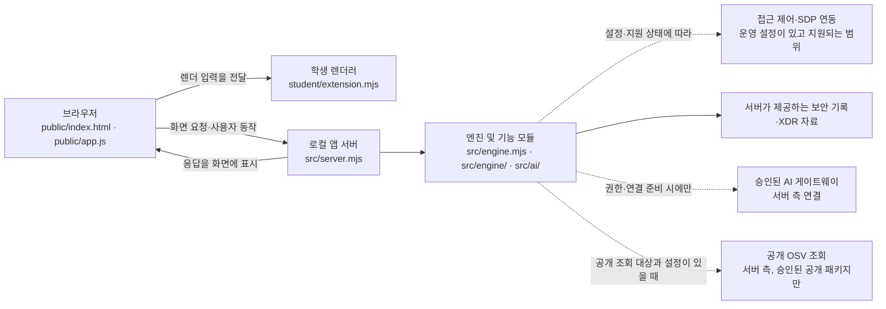

# 학생 실행 설명서와 구성도

이 문서는 저장소의 기존 `README.md`와 실행 안내를 덮어쓰지 않고, 학생이 앱을 실행하고 현재 구현 범위를 확인할 수 있도록 덧붙인 설명입니다. 코드에 적힌 설정·환경변수 이름은 설명에 꼭 필요한 경우가 아니면 나열하지 않습니다. 비밀번호, 토큰, API 키와 개인 설정값을 이 문서에 기록하지 마세요.

## 1. 목적과 기능

이 프로젝트는 브라우저에서 로컬 앱 서버를 열어 로그인 사용자·기기·세션, 업무 앱 접근 판정, 보안 기록과 XDR 경보, AI 연결·이벤트 설명, 설치 패키지 취약점 조회 및 보안 조치 상태를 표시하는 학생용 보안 Agent입니다.

화면의 세 메뉴는 **보호 현황**, **업무 앱**, **보안 기록**입니다. 판정·기록·AI 설명·실제 조치 처리는 서로 다른 기능입니다. 특히 AI 연결 또는 모델 목록 점검이 성공해도 선택한 보안 이벤트의 설명이 실행된 것은 아니며, AI 제안만으로 보안 조치가 실행되는 것도 아닙니다.

## 2. 지원 환경과 실제 확인 범위

| 항목 | 현재 저장소에서 확인한 내용 |
| --- | --- |
| 운영체제 및 실행 방법 | PowerShell 시작 스크립트가 제공됩니다. 이 안내는 Windows PowerShell 경로를 설명합니다. 다른 운영체제에서의 실행은 확인하지 않았습니다. |
| Node.js | `on-client/package.json`의 `engines.node`는 `24.19.0`입니다. 이는 프로젝트가 요구하는 버전이며, 이 문서를 작성하면서 PC에 설치된 실제 Node.js 버전을 실행해 확인한 것은 아닙니다. |
| 패키지 | `package.json`에는 외부 `dependencies` 항목이 없습니다. 이 안내에서는 `npm install`을 실행 절차로 요구하지 않습니다. |
| 잠금 파일 | 현재 도구에서 `on-client/package-lock.json`을 읽을 수 없었습니다. 실제 설치 의존성 버전과 잠금 파일을 대조했다고 주장하지 않습니다. |
| 앱 주소 | 기존 실행 안내에서 사용하는 로컬 주소는 `http://127.0.0.1:5189/`입니다. 공용 서비스 주소가 아닙니다. |
| 실제 실행 시험 | 이 문서 작성 중 앱·브라우저·실제 계정 연결·외부 AI 요청은 실행하지 않았습니다. 아래 절차는 코드와 저장소 안내를 바탕으로 하며, PC에서 직접 확인해야 합니다. |

`package.json`에는 `start`, `demo`, `check` 스크립트가 있습니다. `check`는 학생 확장 파일의 Node.js 구문 확인용입니다. `demo`는 예제 자료 모드이며 실제 계정·서비스 연결 성공을 의미하지 않습니다.

## 3. 프로젝트 폴더와 실행

대상 폴더는 저장소 안의 **`on-client`**입니다. 그 폴더 안에 `package.json`, `public/`, `src/`, `student/`, `tools/`, `docs/`가 있습니다.

1. 파일 탐색기에서 프로젝트의 `on-client` 폴더를 엽니다.
2. 폴더 창의 주소 표시줄에 `powershell`을 입력하고 Enter를 눌러, 현재 위치가 `on-client`인 PowerShell을 엽니다.
3. 필요하면 Node.js 버전을 확인합니다. 프로젝트가 요구하는 출력은 `v24.19.0`입니다. 실제 출력이 다르면 담당자의 설치 안내를 따르세요.

   ```powershell
   node --version
   ```

4. 앱을 시작합니다.

   ```powershell
   powershell -NoProfile -ExecutionPolicy Bypass -File .\tools\start-alekov.ps1
   ```

5. 시작 스크립트를 실행한 PowerShell 창을 열어 둔 채 브라우저에서 다음 주소를 엽니다.

   ```text
   http://127.0.0.1:5189/
   ```

   브라우저에 앱 화면이 열리고 PowerShell에서 앱 서버가 계속 실행 중이면 로컬 화면에 접속한 것입니다. 서버가 시작됐다는 사실만으로 계정 연결, 접근 제어 연동, AI 권한 또는 실제 AI 설명이 성공했다고 판단하지 마세요.

### 종료와 재실행

앱 서버를 시작한 PowerShell 창을 선택하고 **Ctrl+C**를 눌러 종료합니다. 다시 시작하려면 앞의 실행 절차를 같은 `on-client` 폴더에서 수행합니다. 이미 서버가 실행 중이면 먼저 해당 창에서 종료한 뒤 재실행하세요. 브라우저 새로고침은 서버를 재시작하는 명령이 아닙니다.

선택적으로 학생 확장 파일의 구문을 확인하려면 `on-client` 폴더에서 실행합니다.

```powershell
npm run check
```

이 명령은 구문 검사일 뿐 앱 화면·계정 권한·외부 서비스 연결의 동작 시험은 아닙니다. 이 문서 작성자는 실행하지 않았습니다.

## 4. 시스템 구성과 데이터 흐름

아래는 코드 위치와 역할을 요약한 논리 구성도입니다. 조건부·서버 측 연동을 실제 운영 연결 성공으로 해석하지 마세요.



브라우저는 제공 UI와 학생 렌더 함수를 사용하고, 자료 요청은 로컬 앱 서버가 처리합니다. 서버 측 모듈이 엔진·기록·AI·OSV 기능과 연결되는 구조입니다. 점선 연결은 조건부 연동을 뜻하며, 이 문서가 현재 PC에서 그 연동이 준비되었거나 성공했다고 보증하는 것은 아닙니다. 브라우저 주소창에서 `/api/...` 경로를 직접 호출하거나 키를 브라우저 코드에 넣지 마세요.

관련 파일 경로는 `on-client/public/index.html`, `on-client/public/app.js`, `on-client/student/extension.mjs`, `on-client/src/server.mjs`, `on-client/src/engine.mjs`, `on-client/src/ai/service.mjs`, `on-client/src/vulnerabilities/osv.mjs`입니다. SDP 연결 모듈 경로는 `on-client/src/engine/sdp-host.mjs`와 `on-client/src/engine/sdp-host-config.mjs`입니다. SDP·AI의 운영 자격과 권한은 학생 문서에 쓰거나 직접 설정할 값이 아닙니다.

## 5. 제공 코드와 학생 렌더 함수

`public/index.html`과 `public/app.js`는 메뉴, 요청·새로고침, 서버 응답 처리 등 제공 UI의 영역입니다. `student/extension.mjs`의 `createStudentView()`가 반환하는 렌더 함수는 학생 표시 영역입니다. 제공 UI와 학생 렌더러는 별도이며, 제공된 UI만으로 학생 구현이 완료되는 것은 아닙니다.

| 함수 | 학생 표시 기능 / 입력 계약의 요점 |
| --- | --- |
| `renderIdentity({ me, devices, sessions })` | 사용자·현재 기기·세션과 목록을 로딩·오류·자료 상태로 나누고 상태 코드를 표시합니다. |
| `renderDecision({ status, mode, data, error, appId })` | 업무 앱 접근 요청의 대기·확인 중·결과·요청 오류를 구분합니다. 판정은 실제 앱 접속 성공을 보장하지 않습니다. |
| `renderEvents({ status, mode, data, error })` | 전달된 최근 보안 기록을 정렬·필터링하고 각 기록의 근거·규칙·접속·세션·기기 상태를 표시합니다. 기록을 여는 것만으로 새 XDR 탐지를 수행하지 않습니다. |
| `renderStatus({ devices, sessions, notifications, diagnostics, mode })` | 기기·세션의 대기·빈 목록·실패, 알림, 허용된 진단 필드와 사용자 동작에 의한 도움정보 복사를 표시합니다. |
| `renderVulnerabilities({ status, mode, data, error })` | 20단계 대상입니다. 대화에 제공된 저장소 내용에는 기본 대기 문구가 있었고, 사용자가 PowerShell에서 함수 교체 스크립트를 실행했다고 보고했습니다. 그 실행은 기록에 보이지만 이후 `git diff`, 최종 함수 원문 재확인, 구문·화면 시험 결과는 제공되지 않아 현재 저장 파일과 범위는 독립적으로 확인하지 못했습니다. |
| `renderAiConnection({ status, mode, data, error, checkedAt, explanationAccepted })` | AI 연결 점검 상태와 점검 종류·모델 수·시각, 안전한 오류 안내를 표시합니다. 모델 목록 점검과 이벤트 설명은 별도입니다. |
| `renderExplanation({ event, explanation, checkedAt })` | 이벤트에 결속된 참고용 설명·근거·규칙·상태·제안을 표시합니다. 근거 불일치·오류를 성공으로 표시하거나 조치를 실행하는 함수가 아닙니다. |
| `renderAction({ status, event, actionId, target, receipt, observation, message, confirmationExpiresAt, error })` | 준비·전달·접수·관측 결과를 구분합니다. 서버 접수(ACK)는 효과 확인이 아니며, 효과 확인 표시는 관측 자료의 `effectApplied === true`일 때만 해당합니다. 학생 렌더러가 요청 버튼이나 조치 전송을 추가하는 기능은 아닙니다. |

표는 함수의 목적과 계약을 설명하며, 런타임에서 각 분기가 확인됐다는 뜻은 아닙니다. 특히 20단계 함수는 현재 작업 트리에서 재확인해야 합니다.

## 6. 오류·미조회 상태 확인 순서

| 화면 또는 문제 | 구분 / 안전한 다음 확인 |
| --- | --- |
| 브라우저가 로컬 주소를 열지 못함 | 앱을 시작한 PowerShell 창이 열려 있고 서버가 종료되지 않았는지 확인합니다. 창에 나온 오류를 읽고, `on-client` 폴더에서 실행했는지와 `node --version`이 요구 버전인지 확인합니다. 출력에 비밀값이 있으면 공유하지 마세요. |
| Node 명령을 찾을 수 없거나 버전이 다름 | Node.js 설치/PATH를 담당자 안내에 따라 확인합니다. 실행 설정이나 프로젝트 파일을 임의로 바꾸지 마세요. |
| 로그인·AI 연결이 `확인 불가` 또는 권한 준비 중 | 성공으로 간주하지 않습니다. 제공 화면의 상태 안내를 따르고, 반복 연결이나 키 입력을 피합니다. 권한·게이트웨이 준비는 운영 담당자 확인이 필요할 수 있습니다. |
| AI 연결 점검은 되었지만 이벤트 설명이 안 됨 | 연결 점검은 모델 목록·연결 확인이며 사건 설명은 별도 요청입니다. 설명 기능이 준비되지 않았으면 미확인으로 남기고 유료 요청을 반복하지 마세요. |
| 보안 기록이 비어 있음 또는 불러오기 실패 | 빈 목록과 실패는 서로 다른 상태입니다. 화면의 문구와 다시 불러오기 결과를 확인합니다. 최근 기록 범위가 전체 직원 로그나 실시간 전체 탐지를 뜻하지는 않습니다. |
| 취약점 조회가 `not_configured`, `not_checked`, `unverifiable` 또는 `partial` | 이 상태는 “취약점 없음”이 아닙니다. 허용된 공개 조회 대상과 조회 범위를 담당자 안내에 따라 확인합니다. 패키지를 낮추거나 비공개 패키지 이름을 외부로 보내지 마세요. `partial`에는 이미 받은 항목이 있을 수 있습니다. |
| 보안 조치 버튼이 나타나지 않음 | 현재 기록의 지원 조치가 비어 있으면 버튼이 없는 것이 정상입니다. 시험 삼아 조치를 요청하지 마세요. `pending`도 효과 확인이 아닙니다. |

도움정보를 담당자에게 전달할 때도 확인번호·계정 인증정보·비밀번호·토큰·API 키는 포함하지 마세요. 진단 자료를 이 대화에 붙여 넣을 필요는 없습니다.

## 7. 21·22단계 제출 준비 안내

이 설명서는 제출 명령이나 커밋 번호를 대신 만들지 않습니다. 최종 제출 전에는 학생 문서와 해당 단계 코드를 같은 커밋에 포함하고, 저장소 최상위 폴더에서 변경 목록과 diff를 확인해 기존 작업을 보존하세요. 비밀번호·토큰·API 키 파일과 무관한 파일을 추가하지 말고, 기존 원격 주소를 바꾸거나 강제 push·reset·삭제를 하지 마세요.

현재 워크벤치의 **「포털 제출 준비」**는 13~20단계용이라고 안내되어 있습니다. 21·22단계는 과제 화면에서 저장소 주소와 실제 40자리 커밋 해시를 직접 제출합니다. 비공개 저장소를 공개로 바꾸지 않아도 됩니다.

비공개 저장소의 원문이 요구되면 해당 단계 화면에서 **「비공개 저장소 원문 준비 방법」**을 펼치고 **「원문 전달 도구 받기」**를 사용하세요. 안내된 ZIP은 프로젝트 바깥에 압축을 풀고, JSON 출력용 새 폴더도 프로젝트 바깥에 만듭니다. 제출할 프로젝트의 Git 최상위 폴더에서 PowerShell을 열고, 과제 화면에 표시된 `student-source-cli.mjs` 명령을 따르세요. 화면의 실제 구문을 확인하지 못한 상태에서 도구 경로·출력 경로·`--commit` 값을 추측해 명령을 만들지 마세요. 본인 PC의 경로와 제출할 40자리 커밋을 확인한 후에만 해당 값을 지침에 맞게 지정합니다.

도구가 만드는 원문 묶음은 커밋된 원문을 묶기 위한 자료이며, 학생 코드를 실행하거나 업로드하는 단계가 아닙니다. 생성된 JSON은 같은 단계의 **「비공개 저장소 원문 묶음」**에서 선택해 저장소·커밋·단계를 대조한 뒤 제출합니다. 원문 전달 완료와 AI 검토 통과는 서로 다릅니다. 원문 전달만 실패했다면 기존 접수를 유지하고 화면에 안내된 **「원문만 다시 보내기」** 절차를 사용하세요. 실제 명령은 과제 화면의 최신 안내를 따르며, 커밋 해시는 Git에서 실제로 확인한 값을 사용합니다.

## 8. 확인한 것과 아직 확인하지 않은 것

- **코드·저장소 안내를 읽어 확인:** `package.json`의 Node.js 요구 버전과 스크립트, 제공 시작 스크립트 경로, UI·서버·학생 모듈의 파일 위치, 기존 문서에 적힌 로컬 주소를 대조했습니다.
- **대화에서 확인한 실행 보고:** 사용자가 함수 교체 PowerShell 스크립트가 완료됐다는 출력을 제공했습니다. 이는 `renderVulnerabilities` 최종 diff나 코드 동작을 검증한 결과가 아닙니다.
- **실행하지 않음:** Node 버전 확인, `npm run check`, 앱 시작, 브라우저 화면, 실제 계정·SDP·XDR·AI 연결, OSV 조회, 오류·취소·늦은 응답 시험을 수행하지 않았습니다.
- **문서 작성 시 미확인:** PC의 Node.js 실설치 버전, 현재 작업 트리의 Git 변경·스테이징 상태, 20단계 함수 최종 저장 내용과 diff, 모든 실제 연동·권한 및 실제 화면 동작입니다.

이 문서는 이 항목들을 성공이나 통과로 주장하지 않습니다. 문서와 구현의 차이를 발견하면 코드를 임의로 덮어쓰지 말고 담당자 또는 로컬 모델과 현재 diff를 먼저 검토하세요.
